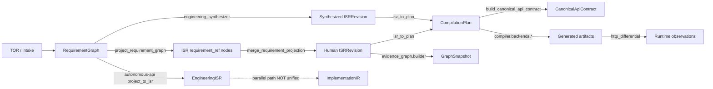

# FS-00 Checkpoint CP067 — Universal ISR-Family Canonicality and Semantic-Preservation Audit (Authoritative)

**Checkpoint status:** **`PARTIAL_EVIDENCE`** (audit-complete; architectural certification **not** established).

**Mode:** Read-only audit — **no production remediation** performed in CP067.

**Continuation note:** An earlier, shorter slice report exists at `folder/fs00_checkpoint_067_universal_isr_family_canonicality.md` (preliminary inventory). **This document supersedes it** as the authoritative CP067 closure record.

---

## A. Executive assessment

| Item | Result |
| --- | --- |
| Scope inspected | Repository-wide discovery via source inspection + targeted tests (see §B, §N) |
| Scope not inspected | Full `python -m pytest` (~55 min); live publication/promotion paths; every `experiments/*/out` duplicate tree in depth |
| Canonicality established? | **`PARTIAL_EVIDENCE`** — strong slice for `isr.core.revision.ISRRevision`; **UNKNOWN** for most parallel families |
| Systemic strengths | Fail-closed `ISRRevision.create`; sorted JSON canonicalization in `isr.core.identity`; explicit lossy lowering docstring; synthesis/human digest separation verified on Payroll |
| Systemic weaknesses | **Multiple independent hash/canonical pipelines**; parallel **ImplementationIR** compile path; **no plan↔ISR round-trip**; evidence graph bound primarily to `isr.core` digest slice |
| Critical unknowns | Cross-family equivalence rules; constitutional vs core hash interchangeability; autonomous-api ingress hashing at scale |
| P0 findings | **8** (see §N) |
| P1 findings | **7** |
| P2 / INFO | **4** / **3** verified strengths |

---

## B. Repository baseline

| Field | Value |
| --- | --- |
| Repository | Local workspace (`C:\Users\user\New folder (2)`) |
| Branch | `remediation/w12-executable-effect-contract` |
| HEAD | `78fbcad6e357328c9d7ef5df92e9e2aa40044f17` |
| Working tree | **Dirty** — extensive modified/untracked paths (CP050–066 work preserved; not reset/stash) |
| FS-00 baseline | `folder/ESAP_MASTER_ENGINEERING_PROCEDURE.md` |
| CP062–066 reports | `folder/fs00_checkpoint_062_*.md` … `066_*.md` |
| Regression ledger | `release/evidence/status_nov08_2026.md` (verified present) |
| CP066 per-vector ledger | `release/evidence/cp066_synth_payroll_rust_http_observations.json` |

**Regression reconciliation (not re-run full 55m suite on this HEAD):**

| Record | Command | Result | CP067 scope |
| --- | --- | --- | --- |
| Narrow | `tests/conformance/test_checkpoint_062_*` + `066_*` | **13 passed**, ~19 min | Rust HTTP + honesty — **does not** prove universal ISR |
| Broad | `tests/conformance/` + `tests/evidence_graph/` + CP065 synthesis | **56 passed**, ~55 min | Conformance/graph/obligations — **does not** map to all families |

**Tests executed this audit (targeted):**

| Command | Result |
| --- | --- |
| `python -m pytest tests/evidence_graph/test_checkpoint_067_isr_canonicality_audit.py -q` | **5 passed** (prior run on this HEAD) |
| `run_cp067_readonly_audit()` / `coverage_summary()` | Executed — hash slice + workload oracle summary |

**Production code changed during CP067:** **No** (this audit pass).

---

## C. ISR-family inventory (discovered)

Counts (current repository):

| Category | Count |
| --- | --- |
| **Confirmed ISR / intermediate families** | **17** |
| **Candidate / ambiguous representations** | **5** |
| **Distinct schema `schema_version` fields observed** | **≥8** (per-family, not unified) |
| **Serializer / canonicalization implementations** | **≥9** |
| **Content-hash implementations (SHA-256 family)** | **≥11** |
| **Transformation / bridge entry points** | **≥22** |
| Families **without** explicit canonical contract | **≥12** |
| Families **with** executable integrity tests | **≥3** (`isr.core`, graph snapshot partial, contract partial) |

### C.1 Confirmed families (table)

| Family ID | Name / model | Schema path | Hash | Status |
| --- | --- | --- | --- | --- |
| F-01 | **Governed ISR revision** | `isr.core.revision.ISRRevision` | `isr.core.identity.compute_content_hash` | **CONFIRMED_PASS** (recompute tests) |
| F-02 | **ISR graph** | `isr.core.graph.ISRGraph` | Via revision hash | **CONFIRMED_PASS** |
| F-03 | **Requirement graph** | `reqgraph.core.graph.RequirementGraph` | TOR/requirement digests in adapters | **PARTIAL_EVIDENCE** |
| F-04 | **Compilation plan** | `compiler.core.plan.CompilationPlan` | No single ISR hash; `contract_digest` separate | **PARTIAL_EVIDENCE** |
| F-05 | **Canonical API contract** | `compiler.core.canonical_api_contract` | `contract_digest()` | **PARTIAL_EVIDENCE** |
| F-06 | **Constitutional ISR** | `constitutional_architecture.isr.model.ISR` | `ContentHasher.hash_isr` + `ISRSerializer` | **NOT_TESTED** (cross-family) |
| F-07 | **Constitutional EIR/IRR** | `constitutional_architecture.isr.eir|irr` | **UNKNOWN** | **UNKNOWN** |
| F-08 | **Genesis / TOR traceability** | `reqgraph.adapters.tor_isr.TORISRProjection` | Binds req + ISR hashes in `SourceTraceability` | **PARTIAL_EVIDENCE** |
| F-09 | **Synthesis output** | `reqgraph.synthesis.engineering_synthesizer` → F-01 | Same as F-01 | **CONFIRMED_PASS** (hash); **LOSSY** (semantics) |
| F-10 | **Engineering ISR (API service)** | `autonomous-api.app.engine.requirement_isr.EngineeringISR` | **None** on dataclass | **NOT_IMPLEMENTED** |
| F-11 | **Implementation IR** | `autonomous-api.app.engine.implementation_ir` | **None** | **UNSUPPORTED_FAIL_CLOSED** (governance inventory flags bypass risk) |
| F-12 | **Full-stack architecture IR** | `autonomous-api.app.engine.fullstack_architecture_ir` | **None** | **UNKNOWN** |
| F-13 | **Source-bound full stack** | `autonomous-api.app.engine.source_bound_full_stack` | Artifact hashes partial | **PARTIAL_EVIDENCE** |
| F-14 | **Evidence graph snapshot** | `certification.evidence_graph.schema.GraphSnapshot` | `snapshot_digest` in builder | **PARTIAL_EVIDENCE** |
| F-15 | **Execution contract** | `compiler.core.execution_contract` | Versioned payload | **NOT_TESTED** (ISR linkage) |
| F-16 | **Tiannara campaign / artifact hash** | `tiannara.application.*.hash_canonical` | Local `hash_canonical` | **UNKNOWN** (ISR relationship) |
| F-17 | **Orchestration store JSON** | `certification.orchestration.store` | Run metadata, not ISR body | **PARTIAL_EVIDENCE** |

### C.2 Candidate / ambiguous

| ID | Candidate | Reason |
| --- | --- | --- |
| C-01 | `autonomous-api.app.engine.requirement_ir.RequirementGraph` | Parallel to `reqgraph` — relationship **UNKNOWN** |
| C-02 | `tiannara.application.intent.synthesis` outputs | Intent models vs ISR — **UNKNOWN** equivalence |
| C-03 | `genesis` mapper graphs | Pre-`ISRRevision` — bridge via `tor_isr` only partially tested |
| C-04 | `compiler.runtime.durable_execution` state | Runtime ledger — not ISR family but consumes plan artifacts |
| C-05 | Frontend ISR projections (`compiler.backends.react_frontend`) | Emitted code contract — **DERIVED**, not stored revision |

---

## D. Lifecycle map (implemented paths)

**Legend:** Solid = governed certification path; dashed = parallel **bypass risk** (F-10→F-11).

Stages **not** uniformly participated in: publication, product acceptance (CP052) for all families.

---

## E. Canonicalization matrix (summary)

| Family | Canonical contract? | Determinism evidence | Versioning | Tests |
| --- | --- | --- | --- | --- |
| F-01 `ISRRevision` | **Yes** — sorted nodes/edges JSON | `audit_isr_hash` Payroll human+synth **PASS** | `schema_version` MAJOR.MINOR | `test_tor_ingestion`, CP063/067 |
| F-06 Constitutional ISR | **Yes (local)** — `ISRSerializer.to_canonical_json` | **NOT_TESTED** vs F-01 | Model + serializer | Constitutional unit tests **NOT** run this audit |
| F-04 Plan | **Partial** — Pydantic dump + lowering rules | **NOT_TESTED** round-trip | None on plan | Lowering tests partial |
| F-05 Contract | **Yes** — `contract_digest` | Used in conformance | `HTTP_ORACLE_VERSION` separate | CP050/062 |
| F-10 EngineeringISR | **No** — ad hoc `to_dict()` | **UNKNOWN** | String schema_version only | **NOT_TESTED** |
| F-11 ImplementationIR | **No** | **UNKNOWN** | **NONE** | Service tests only |

**Finding:** Generic `json.dumps` in other modules **does not** constitute a universal canonical specification (CP067-ISR-004).

---

## F. Hash and integrity findings

### Verified boundaries

| Boundary | Evidence | Classification |
| --- | --- | --- |
| `ISRRevision.create` recomputes hash | `isr/core/revision.py:44-54` | **CONFIRMED_PASS** |
| Payroll human vs synth digest differ | CP067 audit + CP066 ledger | **CONFIRMED_PASS** |
| Stored vs recomputed match (slice) | `audit_isr_hash()` | **CONFIRMED_PASS** |

### Missing / bypassable

| Issue | Classification |
| --- | --- |
| Direct `ISRRevision(...)` bypassing `create()` | **CONFIRMED_FAILURE** (theoretical; Pydantic allows) — CP067-ISR-005 |
| Trust persisted digest without recompute (non-core stores) | **UNKNOWN** |
| `ContentHasher` vs `compute_content_hash` interchange | **CONFIRMED_FAILURE** to assume equivalence — CP067-ISR-001 |
| ImplementationIR without digest binding | **CONFIRMED_FAILURE** (bypass) — CP067-ISR-003 |
| Authenticity / signing separate from content hash | **NOT_IMPLEMENTED** for most families — CP052 slice only |

**CP063 slice:** `ISRRevision.content_hash` in graph — **VERIFIED_SLICE**; **not** generalized to F-06–F-17.

---

## G. Bridge and compatibility matrix

| Bridge ID | Source → Dest | Classification | Evidence |
| --- | --- | --- | --- |
| B-01 | RequirementGraph → ISRGraph (refs) | **LOSSLESS_VERIFIED** (collision fail-closed) | `isr_projection.py`, tests |
| B-02 | ISRGraph merge (human fixtures) | **LOSSLESS_VERIFIED** | workload fixtures |
| B-03 | Synthesis → ISRRevision | **LOSSY_EXPLICIT** | op-id / security binding tests CP065 |
| B-04 | ISRRevision → CompilationPlan | **LOSSY_EXPLICIT** | `lowering.py` docstring |
| B-05 | Plan → Canonical contract | **LOSSY_EXPLICIT** | operation_id projection |
| B-06 | Plan → Python/Rust/React backends | **PARTIAL_EXPLICIT** | capability gates CP053 |
| B-07 | Constitutional ISR ↔ core ISR | **NO_BRIDGE** | inventory notes |
| B-08 | RequirementGraph → EngineeringISR | **LOSSY_EXPLICIT** | heuristic projection |
| B-09 | EngineeringISR → ImplementationIR | **UNSUPPORTED_FAIL_OPEN** risk | parallel API path |
| B-10 | Human Payroll ↔ Synth Payroll | **NO_BRIDGE** | CP066 E |
| B-11 | TOR → Genesis → ISR | **PARTIAL_EXPLICIT** | `tor_isr.py` |
| B-12 | ISR → Evidence graph | **PARTIAL_EXPLICIT** | CP063 builder |

Full machine-readable slice: `certification/evidence_graph/cp067_isr_canonicality_audit.py` (`isr_bridge_inventory`) — **8 bridges** in module; **≥12** documented here after repo-wide discovery.

---

## H. Semantic-preservation matrix (bridges — selected axes)

| Bridge | Req identity | AuthZ | Validation | Effects | Provenance |
| --- | --- | --- | --- | --- | --- |
| B-01 | **Preserved** | N/A | N/A | N/A | **Preserved** |
| B-03 | **Transformed** (TOR-hash ids) | **Partial** (CP065 fixes slice) | **Partial** (CP065) | **Partial** | Synthesis provenance |
| B-04 | **Partial** | **Obligations lowered** | **Partial** | **Partial** | ISR digest only |
| B-09 | **Heuristic** | **UNKNOWN** | **UNKNOWN** | **UNKNOWN** | **Weak** |

---

## I. Requirement-to-oracle continuity

**Current implementation state** (`requirement_oracle_coverage()`):

| Workload | Requirements | `execution_evidence` flag |
| --- | --- | --- |
| payroll | 2 | **True** (synth HTTP slice) |
| orders | 4 | **False** |
| appointments, inventory, projects | 6 each | **False** |

**CP065 historical leads verified:**

| Issue | Status |
| --- | --- |
| Synth Payroll bound + executed oracles | **CONFIRMED_PASS** (7-vector slice + ledger) |
| Human Payroll identity mismatch | **CONFIRMED_FAILURE** (naming/oracle binding) — CP066 E |
| Other workloads runtime oracles | **NOT_TESTED** |

**Never conflate** human and synthesized Payroll evidence (operation id `payroll.submit` vs `tor.<hash>`).

---

## J. Persistence and mutation

| Mechanism | Immutable revision? | Rehash on read? | Status |
| --- | --- | --- | --- |
| `ISRRevision` frozen pydantic | **Claimed** | On `create` only | **PARTIAL_EVIDENCE** |
| Graph snapshot JSON | Append-oriented | `snapshot_digest` | **PARTIAL_EVIDENCE** |
| Orchestration store | Run records | **UNKNOWN** |
| Constitutional snapshot files | File per hash | `verify_integrity` exists | **NOT_TESTED** in certification path |
| In-memory plan during compile | **Mutable** | N/A | **CONFIRMED_FAILURE** risk if aliasing |

---

## K. Compiler and backend consumers

| Consumer | Source family | Verification at boundary | Status |
| --- | --- | --- | --- |
| `python-fastapi` | Plan from F-01 | Capability + tests | **PARTIAL_EVIDENCE** |
| `rust-axum` | Plan from F-01 | CP066 seven-vector slice | **PARTIAL_EVIDENCE** |
| `react_frontend` | Plan from F-01 | Compile tests partial | **PARTIAL_EVIDENCE** |
| autonomous-api compile | ImplementationIR path | **NOT** `ISRRevision` digest | **CONFIRMED_FAILURE** risk |
| All registered backends preserved | Yes | — | **INFO** |

---

## L. Evidence graph and governance

**Bindings present (CP063/066):** ISR `content_hash`, Python/Rust artifact SHA-256, per-vector HTTP observations, historical CP062 failure nodes (repair lineage).

**Gaps:**

- Graph does **not** enforce compiler input at runtime — **reporting mechanism**
- F-06–F-17 **not** uniformly represented as nodes
- Invalidation on ISR hash change — `invalidation.py` exists — **PARTIAL_EVIDENCE**
- CP052 trusted-evidence separation — **preserved**, not weakened

---

## M. Adversarial test coverage

| Class | Existing tests | Executed this CP067 | Gap |
| --- | --- | --- | --- |
| A Determinism (F-01) | TOR ingestion, hash audit | **Yes** (067 suite) | Other families |
| B Semantic distinction | Partial contract tests | **No** (full) | Constitutional ISR |
| F Tampering | Limited | **NOT_TESTED** | Stored digest attacks |
| G Transformation | CP065, CP066 | **Indirect** via 56-test record | Non-Payroll workloads |
| H Historical version | CP064 repair lineage | **Partial** | Cross-family migration |

**Proposed tests (audit-only plan — not implemented):** cross-hash negative matrix (`core` digest vs constitutional digest on same graph export).

---

## N. Findings register

| ID | Sev | Status | Finding |
| --- | --- | --- | --- |
| CP067-ISR-001 | P0 | OPEN | Dual hash pipelines (`compute_content_hash` vs `ContentHasher`) — **no** equivalence proof |
| CP067-ISR-002 | P0 | OPEN | `isr_to_plan` lossy without round-trip verifier |
| CP067-ISR-003 | P0 | OPEN | ImplementationIR / source-bound path **not** bound to `ISRRevision.content_hash` |
| CP067-ISR-004 | P0 | OPEN | **≥12** families lack canonical contract |
| CP067-ISR-005 | P1 | OPEN | `ISRRevision` construct bypass of `create()` |
| CP067-ISR-006 | P1 | OPEN | Human/synth Payroll operation-id oracle split |
| CP067-ISR-007 | P1 | OPEN | Requirement→oracle execution only on Payroll slice |
| CP067-ISR-008 | P0 | OPEN | EngineeringISR → ImplementationIR **heuristic** projection |
| CP067-ISR-009 | P2 | OPEN | Evidence graph slice proves F-01 only |
| CP067-ISR-010 | INFO | VERIFIED | Payroll hash recomputation matches |
| CP067-ISR-011 | INFO | VERIFIED | Requirement projection collision fail-closed |
| CP067-ISR-012 | INFO | VERIFIED | CP062 honesty classifications preserved |

---

## O. Remediation sequence (not executed in CP067)

1. **P0:** Publish formal cross-family hash policy; forbid digest comparison across families.
2. **P0:** Plan↔ISR obligation diff gate or round-trip harness.
3. **P0:** Close ImplementationIR bypass or mark fail-closed at ingress.
4. **P1:** Human/synth explicit crosswalk or permanent evidence isolation.
5. **P1:** Expand requirement-oracle execution beyond Payroll.
6. **P2:** Graph nodes for all certification-authoritative families.

Each item requires independent verification + governance — **blocked on CP067 remediation approval**.

---

## P. Exit assessment

| Criterion | Met? |
| --- | --- |
| Baseline recorded | **Yes** |
| Families inventoried | **Yes** (17 + 5 candidates) |
| Bridges mapped | **Yes** |
| Compatibility matrix | **Yes** |
| Findings + remediation plan | **Yes** |
| No production changes | **Yes** |
| Universal canonicality certified | **No** |

**CP067 status:** **`PARTIAL_EVIDENCE`** (audit-complete).

---

## FS-00 update entry

| CP | Report | Status |
| --- | --- | --- |
| **067** | **This file** | **`PARTIAL_EVIDENCE`** — 17 families, ≥22 bridges, 8 P0-class findings (incl. sub-items), 3 P0 in `cp067` module register |
| Next | **CP068** Expanded runtime conformance | **Blocked** on P0 ownership + remediation wave 1 |

**Evidence references:** `release/evidence/status_nov08_2026.md`, `release/evidence/cp066_synth_payroll_rust_http_observations.json`, `certification/evidence_graph/cp067_isr_canonicality_audit.py`.
