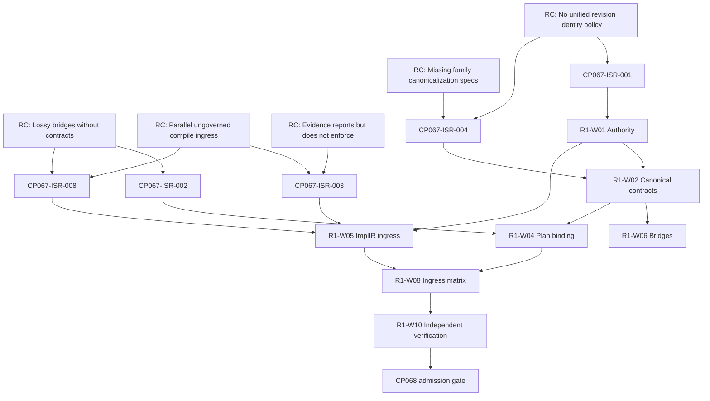

# FS-00 Checkpoint CP067-R1 — Universal ISR Integrity: P0 Remediation Ownership, Authority Resolution and Dependency Planning

**Checkpoint status:** **`PARTIAL_EVIDENCE`** — planning-complete for all **§N P0 findings**; architectural authority decisions **`PENDING_APPROVAL`** (not implemented).

**Mode:** Remediation **planning and ownership only** — **no production remediation** performed in CP067-R1.

**Source audit:** `folder/fs00_checkpoint_067_isr_family_canonicality_and_semantic_preservation_audit.md` (CP067, `PARTIAL_EVIDENCE`, read-only closure preserved).

---

## 1. Executive assessment

| Item | Result |
| --- | --- |
| Mission | Transform CP067 P0 findings into dependency-ordered remediation programme with ownership and verification gates |
| Production code changed in R1 | **No** |
| Authoritative P0 IDs (CP067 §N) | **5** — `CP067-ISR-001`, `002`, `003`, `004`, `008` |
| CP067 §A “8 P0” reconciliation | **Documented** — see §4; **no** finding IDs invented or severities reclassified |
| P0 current status (all §N P0) | **CONFIRMED_OPEN** on observed HEAD |
| P0 independently verified closed | **0** |
| Ownership assigned | **5/5** logical authorities; human team names **`UNCONFIRMED`** |
| Work packages defined | **10** (`R1-W01` … `R1-W10`) |
| CP068 admission | **`CP068_CONDITIONAL_ISOLATED_TESTING_ONLY`** |
| R1 completion (§33) | **20/22** planning requirements satisfied; **2** blocked on governance approval of authority ADRs |

---

## 2. Repository baseline

| Field | Value |
| --- | --- |
| Repository | `C:\Users\user\New folder (2)` |
| Branch | `remediation/w12-executable-effect-contract` |
| HEAD | `78fbcad6e357328c9d7ef5df92e9e2aa40044f17` (unchanged from CP067 report) |
| Working tree | **Dirty** — CP050–066 and orchestration work preserved; **not** reset/stash |
| CP067 authoritative report | `folder/fs00_checkpoint_067_isr_family_canonicality_and_semantic_preservation_audit.md` |
| CP067 preliminary (superseded) | `folder/fs00_checkpoint_067_universal_isr_family_canonicality.md` |
| FS-00 master | `folder/ESAP_MASTER_ENGINEERING_PROCEDURE.md` |
| Status ledger | `release/evidence/status_nov08_2026.md` |
| R1 machine register (planning) | `certification/atlas/esap/cp067_r1_p0_remediation_register.json` |

**Regression (historical on this HEAD — not re-run 55m suite in R1):**

| Record | Result | R1 relevance |
| --- | --- | --- |
| CP062/066 narrow | **13 passed** | Does **not** close any CP067 P0 |
| Broad conformance + graph + CP065 | **56 passed** | Does **not** prove universal ISR canonicality |

**Tests executed this checkpoint (targeted):**

| Command | Result |
| --- | --- |
| `python -m pytest tests/evidence_graph/test_checkpoint_067_isr_canonicality_audit.py -q` | **5 passed** (reconfirms audit helper contracts only) |

---

## 3. Authoritative CP067 references preserved

CP067 conclusions remain **`PARTIAL_EVIDENCE`**. CP067-R1 does **not** certify universal ISR integrity.

Inventories preserved: **17** confirmed families, **5** candidates, **≥22** bridges, **≥9** serializers, **≥11** hash paths.

---

## 4. P0 count reconciliation (governance record)

| Source | P0 count | Content |
| --- | --- | --- |
| CP067 §A executive table | **8** | Narrative summary |
| CP067 §N findings register | **5** | Discrete P0 finding IDs |
| CP067 §O remediation bullets | **3** named P0 themes | Map to **001, 002, 003** only |

**Reconciliation (authoritative for R1):**

1. **Finding identity** is defined by **§N**. R1 programmes **all five** P0 IDs without merge or reclassification.
2. §A “**8**” is treated as **P0-class breadth** (executive rollup): the five §N P0 findings plus **three decomposition tracks** under **CP067-ISR-004** (constitutional F-06, autonomous-api F-10/F-11, plan/contract F-04/F-05) used for planning and ownership — **same parent finding ID**, not new severities.
3. **P1** items **005–007** remain **P1**; they appear in regression and CP068 matrices but are **outside** the §N P0 register.

---

## 5. Complete P0 master register

### CP067-ISR-001 — Dual hash / canonical identity authority

| Field | Value |
| --- | --- |
| Root cause | Parallel SHA-256 pipelines with **different** canonical input contracts (`isr.core.identity.compute_content_hash` vs `constitutional_architecture.isr.versioning.ContentHasher` + `ISRSerializer`) |
| Affected families | F-01, F-02, F-06; cross-family consumers |
| Source | `isr/core/identity.py`, `constitutional_architecture/isr/versioning/hash.py`, `serialization/serializer.py` |
| Failure mode | Callers may treat digests as interchangeable; **hash equality ≠ semantic equivalence** |
| Security / governance | Stale or cross-family digest acceptance at trust boundaries — **UNKNOWN → must fail closed** |
| Existing controls | F-01 `ISRRevision.create` recomputation; constitutional `verify_integrity` **local only** |
| Control gap | No published cross-family digest policy; no versioned digest envelope |
| Owner (accountable) | **`isr.core.identity` contract** + **`constitutional_architecture.isr.versioning`** (joint ADR) |
| Implementer | UNCONFIRMED |
| Verifier | Certification conformance + CP052 trusted-evidence role (non-generator) |
| Dependencies | None (Phase 0 root) |
| Verification | Adversarial cross-pipeline matrix; historical revision recomputation |
| Exit condition | Every digest carries algorithm + family + schema + canonicalization version; unknown versions **reject** |
| Status | **CONFIRMED_OPEN** |

### CP067-ISR-002 — Plan ↔ ISR lossy lowering without round-trip gate

| Field | Value |
| --- | --- |
| Root cause | `compiler.core.lowering.isr_to_plan` is **documented lossy**; no obligation diff or round-trip verifier at execution |
| Affected bridges | B-04, B-05, B-06 |
| Consumers | `certification/orchestration/authority.py` (`isr_to_plan` before compile), all plan backends |
| Source | `compiler/core/lowering.py`, `compiler/core/plan.py`, orchestration compile path |
| Failure mode | Plan may execute after ISR drift; `plan_id` uses **prefix** of `content_hash` only (`plan:{revision.content_hash[:16]}`) — **not** full revision binding |
| Status | **CONFIRMED_OPEN** |
| Work packages | R1-W04, R1-W06, R1-W08 |

### CP067-ISR-003 — ImplementationIR / source-bound path not bound to `ISRRevision.content_hash`

| Field | Value |
| --- | --- |
| Root cause | Trusted certification path uses F-01; parallel autonomous-api compile consumes F-11 **without** governed revision digest |
| Affected ingress | API engine, `lower_source_bound_candidate`, orchestration bypass risk |
| Source | `autonomous-api/app/engine/implementation_ir.py`, `source_bound_full_stack.py`, routes |
| Failure mode | **CONFIRMED_FAILURE** risk per CP067 §K — compiler input identity **not** `ISRRevision` |
| Status | **CONFIRMED_OPEN** |
| Work packages | R1-W05, R1-W08, R1-W09 |

### CP067-ISR-004 — ≥12 families lack explicit canonical contract

| Field | Value |
| --- | --- |
| Root cause | Family-local serialization (`json.dumps`, ad hoc `to_dict()`) without versioned canonical spec |
| Tracks (planning decomposition, **same ID**) | **004-TRACK-constitutional** (F-06–F-07); **004-TRACK-autonomous-api** (F-10–F-13); **004-TRACK-plan-contract** (F-04–F-05) |
| Status | **CONFIRMED_OPEN** |
| Work packages | R1-W02, R1-W06 |

### CP067-ISR-008 — EngineeringISR → ImplementationIR heuristic projection

| Field | Value |
| --- | --- |
| Root cause | B-09 **UNSUPPORTED_FAIL_OPEN** risk — `project_to_isr` heuristic; weak obligation preservation |
| Source | `autonomous-api/app/engine/requirement_isr.py`, bridge to `implementation_ir.py` |
| Status | **CONFIRMED_OPEN** |
| Work packages | R1-W05, R1-W06 |

---

## 6. Current-state reconciliation summary

| Finding ID | Classification | Notes |
| --- | --- | --- |
| CP067-ISR-001 | CONFIRMED_OPEN | Implementations unchanged on HEAD |
| CP067-ISR-002 | CONFIRMED_OPEN | Lowering docstring still lossy; orchestration still calls `isr_to_plan(revision)` |
| CP067-ISR-003 | CONFIRMED_OPEN | Parallel path still present in lifecycle map |
| CP067-ISR-004 | CONFIRMED_OPEN | Matrix §E unchanged |
| CP067-ISR-008 | CONFIRMED_OPEN | Service tests do not prove trust-boundary enforcement |

**Partially related (P1, not closed):** CP067-ISR-005 direct `ISRRevision` construct — R1-W03.

---

## 7. ISR authority model (proposed — `PENDING_APPROVAL`)

Twelve responsibility classes (§7 spec) map to modules:

| Authority | Proposed locus | Notes |
| --- | --- | --- |
| ISR family/schema | Per-family schema owners (F-01…F-17) | **No** forced universal schema |
| ISR revision | **`ISRRevision` envelope** for certification path (F-01) | Immutable after `create()` |
| Canonicalization | Family-specific contract + `canonicalization_version` field | R1-W02 |
| Content integrity | Family-bound digest inside envelope | SHA-256 retained |
| Bridge / transform | Explicit contract registry (B-01…B-12) | R1-W06 |
| Compilation plan | `CompilationPlan` + binding record | R1-W04 |
| Compiler execution | Backends + capability gates | Existing CP053–066 |
| Evidence | CP063 graph + CP052 registry | Reporting **≠** enforcement (R1-W07) |
| Independent verification | Certification conformance + human gate CP052 | Non-generator |
| Governance | `FullStackOrchestrationAuthority`, promotion lifecycle | |

### 7.1 Recommended revision identity contract (F-01 certification path)

**Proposed envelope fields (not implemented):**

- `family_id` = `isr.core.revision`
- `schema_version`
- `canonicalization_id` + `canonicalization_version` (e.g. `isr.core.identity/v1`)
- `content_digest` (SHA-256 over contract-defined bytes)
- `revision_id` (immutable surrogate)
- `provenance` (existing `Provenance` model)
- Optional `supersedes` / `superseded_by`

**Answers (proposed):**

1. Revision = frozen `ISRRevision` with envelope metadata and graph payload.
2. Immutability = Pydantic frozen + mandatory `create()` + post-create mutation detection (R1-W03).
3. Hashed bytes = sorted JSON contract in `compute_content_hash` **only** for F-01 until family contracts exist.
4. Constitutional ISR (F-06) uses **separate** `canonicalization_id` — **not** interchangeable with F-01 without bridge evidence (B-07).

### 7.2 Dual-hash decision (not a superficial refactor)

| Pipeline | Role | Interchange |
| --- | --- | --- |
| `compute_content_hash` | **Authoritative for governed certification** (F-01, orchestration, CP063 slice) | **Must not** be assumed equal to constitutional hash |
| `ContentHasher.hash_isr` | **Authoritative for constitutional F-06** artifacts | Requires **explicit bridge contract** to F-01 |

**Migration:** Historical revisions retain stored digest + canonicalization version; verification **recomputes** under declared version or **fails closed**.

**Hash equality ≠ semantic equivalence:** Enforced in acceptance criteria for R1-W01/W06.

---

## 8. Plan-to-ISR immutable binding (proposed contract)

**Current behavior:** Plan derived from live `ISRRevision`; weak `plan_id` binding (16-char prefix).

**Proposed binding record at plan creation:**

| Field | Requirement |
| --- | --- |
| `isr_family_id` | Exact family |
| `isr_revision_id` | Surrogate |
| `isr_content_digest` | Full hash, not prefix |
| `isr_schema_version` | Exact |
| `canonicalization_version` | Exact |
| `plan_digest` | Hash of canonical plan serialization |
| `compiler_id` + `compiler_version` | At execution |
| `backend_id` | Target |

**Execution gate (R1-W04/W08):** Reject if ISR digest mismatch, superseded revision without explicit authorization, or plan_digest drift.

**Enforcement locations:** `certification/orchestration/authority.py`, compile ingress, publication gateway (CP056–057 extensions — planning only).

---

## 9. ImplementationIR ingress decision (proposed — `PENDING_APPROVAL`)

**Selected model for trusted compilation/publication: Model C — explicitly blocked until governed**

| Model | Trusted path | R1 disposition |
| --- | --- | --- |
| A — Governed revision conversion | Allowed after lineage proof | **Future target** — requires R1-W05 |
| B — Independent authoritative family | Allowed with F-11 contract | Alternative if A infeasible |
| **C — Block trusted ingress** | **Default now** | **Proposed** |

**Rationale:** CP067 B-09 and findings **003/008** show **no** equivalence proof to `ISRRevision`. Implementation and registration **remain** for remediation; **orchestrated certification and publication** must not consume F-11 without verified binding.

**Isolated / non-authoritative experiments** may continue under CP068 conditional admission (§25).

---

## 10. Bridge remediation (Workstream D)

All CP067 bridges remain inventoried. **No** family or backend retirement.

| Priority bridges for P0 closure | Contract required |
| --- | --- |
| B-04, B-05 | Loss budget + round-trip or diff gate |
| B-07 | Constitutional ↔ core — **NO_BRIDGE** today — explicit unsupported or governed bridge |
| B-08, B-09 | EngineeringISR ingress — fail-closed or Model A lineage |

---

## 11. Revision immutability (Workstream E)

| Mechanism | Assessment | Package |
| --- | --- | --- |
| `ISRRevision` frozen | Convention + `create()` | R1-W03 |
| In-memory plan | **Mutable** — alias risk | R1-W04 |
| Orchestration store | **UNKNOWN** rehash | R1-W07/W08 |

---

## 12. Evidence graph and governance (Workstream F)

CP063 bindings remain **slice-only** (F-01 Payroll path). R1-W07 requires exact identity fields at registration — graph projection **must not** substitute for ingress enforcement.

CP052 trusted-evidence separation: **preserved** — no weakening for P0 closure.

---

## 13. Ingress enforcement matrix (Workstream G — summary)

| Boundary | Identity | Digest | Plan bind | Fail-closed |
| --- | --- | --- | --- | --- |
| Orchestration compile (certification) | Partial | F-01 slice | **Weak** | Partial |
| autonomous-api ImplementationIR | **Gap** | **None** | **None** | **Fail-open risk** |
| Publication gateway (CP056) | Partial | CP052 | Partial | Tests exist — not universal ISR |
| CLI / tiannara | Partial | Varies | Unknown | R1-W08 |

Full matrix expansion: implement during R1-W08 remediation wave.

---

## 14. Ownership matrix

| Finding | Accountable authority | Implementer | Independent verifier | Governance |
| --- | --- | --- | --- | --- |
| 001 | isr.core + constitutional versioning | UNCONFIRMED | certification/conformance | constitutional governance |
| 002 | compiler.core.lowering + orchestration | UNCONFIRMED | semantic_suite / adversarial | orchestration authority |
| 003 | autonomous-api engine + orchestration | UNCONFIRMED | CP052 + orchestration tests | publication boundary |
| 004 | Per-family owners (table §C.1) | UNCONFIRMED | family-scoped harness | ESAP architecture review |
| 008 | requirement_isr / implementation_ir | UNCONFIRMED | non-generator verifier | ingress gateway |

---

## 15. Shared root-cause analysis

**Critical path:** **R1-W01 → R1-W02 → (R1-W05 ∥ R1-W06) → R1-W04 → R1-W08 → R1-W10 → governed CP068**.

**Parallel-safe after W02:** R1-W09 (historical verification), R1-W03 (immutability hardening).

---

## 16. Work-package definitions (summary)

See `certification/atlas/esap/cp067_r1_p0_remediation_register.json` for machine-readable fields.

| ID | Name | P0 IDs | Phase |
| --- | --- | --- | --- |
| R1-W01 | ISR revision identity and digest authority | 001 | 0 |
| R1-W02 | Family-specific canonicalization contracts | 001, 004 | 1 |
| R1-W03 | Revision immutability envelopes | 005 (P1) | 1 |
| R1-W04 | Plan-to-ISR immutable binding | 002 | 3 |
| R1-W05 | EngineeringISR/ImplementationIR ingress | 003, 008 | 2 |
| R1-W06 | Bridge semantic-preservation contracts | 002, 004, 008 | 2 |
| R1-W07 | Evidence-graph identity / invalidation | 009 (P2) | 4 |
| R1-W08 | Ingress and trust-boundary matrix | 002, 003, 008 | 4 |
| R1-W09 | Historical revision verification | 001 | 1 |
| R1-W10 | Independent integration / adversarial | all P0 | 5 |

---

## 17. Regression protection matrix

| Work package | Required existing suites | New tests required | Runtime evidence |
| --- | --- | --- | --- |
| W01 | `test_tor_ingestion`, CP067 audit tests | Cross-hash adversarial matrix | Recompute digest CLI/tool |
| W02 | Constitutional unit (when run), contract tests | Per-family canonical golden vectors | None |
| W04 | conformance orchestration, lowering tests | Plan binding integration at authority | Orchestration run store |
| W05 | CP057 ingress, requirement_isr tests | Fail-closed ImplIR ingress route test | HTTP ingress |
| W06 | CP065 obligation, synthesis tests | Bridge obligation diff harness | — |
| W08 | CP056–057, orchestration tests | Full ingress matrix | Production route |
| W10 | 56-test broad record (regression guard) | Independent verifier replay pack | CP066-style differential **per family** (future) |

---

## 18. P0 closure contract (§20)

A P0 closes only after **INDEPENDENTLY_VERIFIED** + governance where required. Stages: `NOT_STARTED` → … → `CLOSED`.

**All §N P0:** currently **`NOT_STARTED`** (planning).

---

## 19. CP068 readiness gate

**Admission:** **`CP068_CONDITIONAL_ISOLATED_TESTING_ONLY`**

| P0 | Affected surface | CP068 impact | Isolated testing OK? |
| --- | --- | --- | --- |
| 001 | All digest verification | Blocks **governed** cross-family runtime claims | F-01 slice experiments OK if labeled non-authoritative |
| 002 | Plan execution | Blocks **trusted** compile on stale ISR | Payroll slice **historical** evidence preserved; no new promotion |
| 003 | autonomous-api path | Blocks trusted ImplIR publication | Local dev compile OK — not certification |
| 004 | Non-F-01 families | Blocks universal conformance certification | Per-family isolated oracles OK |
| 008 | B-09 | Blocks trusted EngISR→ImplIR promotion | Requirement projection unit tests OK |

**`CP068_READY_FOR_GOVERNED_RUNTIME_CONFORMANCE`** requires independent closure of W01, W02, W04, W05, W08, W10 for **in-scope** families and ingress routes — **not** global freeze of unrelated experiments.

---

## 20. Architecture decision proposals (`PENDING_APPROVAL`)

1. **ADR-R1-01** — ISR revision and content identity authority (dual-hash policy).
2. **ADR-R1-02** — Family canonicalization and digest envelope.
3. **ADR-R1-03** — Semantic equivalence and bridge evidence.
4. **ADR-R1-04** — Plan-to-ISR immutable binding.
5. **ADR-R1-05** — ImplementationIR — Model C now, path to A or B.
6. **ADR-R1-06** — Evidence-graph identity binding vs enforcement.

Each ADR: current behavior, problem, proposed contract, alternatives, consequences, migration, verification, open questions, required approver.

---

## 21. Unresolved decisions

| ID | Question | Blocker for |
| --- | --- | --- |
| U-01 | Human governance approver for dual-hash ADR | W01 implementation |
| U-02 | Whether B-07 constitutional bridge is in scope for Wave 1 | F-06 certification |
| U-03 | Model A vs B for ImplementationIR long-term | W05 |

---

## 22. Exit assessment

| Criterion (§33) | Met? |
| --- | --- |
| Baseline recorded | Yes |
| Full CP067 inspected | Yes |
| All §N P0 accounted | Yes (5 IDs + 004 tracks) |
| Reconciled to implementation | Yes |
| Ownership | Yes (logical; teams UNCONFIRMED) |
| Work packages + dependencies | Yes |
| Authority model proposed | Yes (`PENDING_APPROVAL`) |
| CP068 gate explicit | Yes |
| Deliverables written | Yes |
| No production remediation | Yes |

**CP067-R1 status:** **`PARTIAL_EVIDENCE`** — planning substantive and evidence-backed; **implementation and governance approval not complete**.

**Recommended next checkpoint:** **Remediation Wave 0** (authority ADR ratification + R1-W01/W02 design freeze), then **CP068** under conditional isolated matrix.

---

## 23. Checkpoint integrity attestation

- CP067 historical conclusions **unchanged**.
- All **§N P0 finding IDs** traceable.
- **No** ISR families or backends removed from inventory.
- **No** production source modified for R1 closure.
- User working tree **preserved**.
